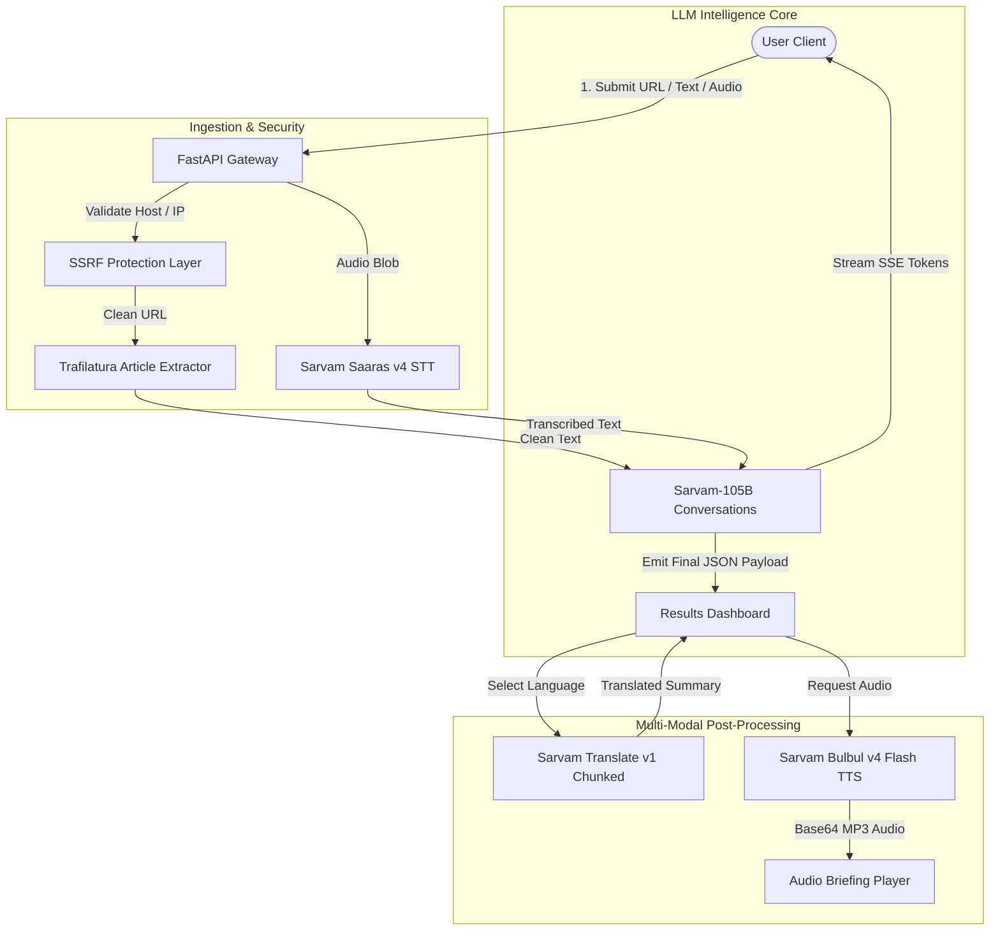

<div align="center">

# Vaani — Multilingual News Intelligence Agent

<p align="center">
  <strong><em>"Every story. Every language. One perspective."</em></strong>
</p>

<p align="center">
  <a href="https://github.com/ayush-thedev/Vaani/stargazers"></a>
  <a href="https://github.com/ayush-thedev/Vaani/network/members"></a>
  <a href="https://github.com/ayush-thedev/Vaani/blob/main/LICENSE"></a>
  
  
  
  
  
  
</p>

<p align="center">
  Transform noisy, long-form news articles from across India into structured, verified intelligence briefings. Extract key entities, stream facts in real time, translate seamlessly into 23 Indian languages, and listen with natural regional voice narration.
</p>

---

</div>

## Table of Contents
- [Overview](#overview)
- [Key Features](#key-features)
- [Sarvam AI Model Stack](#sarvam-ai-model-stack)
- [Supported Languages (23 Official Languages)](#supported-languages-23-official-languages)
- [Architecture & Data Pipeline](#architecture--data-pipeline)
- [Security & Resilience](#security--resilience)
- [API Reference](#api-reference)
- [Project Structure](#project-structure)
- [Getting Started](#getting-started)
- [Roadmap](#roadmap)
- [License](#license)

---

## Overview

News consumption in multilingual societies faces three major bottlenecks:
1. **Language Barriers**: Local reporting in regional scripts remains inaccessible to readers from other states.
2. **Information Overload**: Lengthy articles bury critical figures, names, and developments beneath editorial fluff.
3. **Accessibility**: Readers often prefer audio briefings on the go or need voice dictation to process articles hands-free.

**Vaani** is designed as a sovereign news intelligence platform built on top of **Sarvam AI's** suite of Indic models. It handles content extraction, factual synthesis, multi-entity classification, sentence-boundary chunked translation, and regional-accent audio briefings.

---

## Key Features

### 1. Triple Input System
* **URL Extraction**: Ingest articles directly from web URLs with automated boilerplate, ad, and navigation removal using `trafilatura`.
* **Pasted Content**: Clean paste interface with real-time character counters and truncation safeguards (up to 50,000 characters).
* **Voice Dictation (Speech-to-Text)**: Live in-browser microphone recording with one-click transcription powered by **Saaras v4** (`saaras:v4`).

### 2. Real-Time Streaming Intelligence Briefings
* Powered by **Sarvam-105B Conversations** (`sarvam-105b-conversations`).
* Token-by-token **Server-Sent Events (SSE)** streaming: see words materialize as reasoning executes.
* Standardized 5–7 sentence factual executive summaries without hallucinations or speculative bias.

### 3. Automated Entity Classification
* Deep extraction and categorisation of critical entities:
  * **People**: Key political leaders, executives, scientists, and officials.
  * **Organizations**: Agencies, startups, ministries, and companies.
  * **Locations**: Cities, space centres, states, and geographic points of interest.
  * **Dates**: Temporal points of milestone achievements or event deadlines.
  * **Statistics**: Financial figures, cost estimates, percentages, and metrics.

### 4. Full Indic Translation (All 23 Languages)
* Integrated with **Sarvam Translate** (`sarvam-translate:v1`) in formal register mode.
* Intelligent **sentence-boundary chunking** (< 1,800 characters) to respect API quotas without breaking linguistic context.
* Features quick-pick pills for top languages plus a native script dropdown covering all 22 Scheduled Indian Languages + English.

### 5. Natural Audio Briefings (Text-to-Speech)
* Integrated voice player powered by **Bulbul v4 Flash** (`bulbul:v4-flash`).
* Listen to the briefing in English or in the selected Indic regional translation.
* Complete custom playback UI: Play / Pause, scrubber timeline, elapsed/total time readout, and restart.

### 6. Editorial-Grade Dashboard
* Aesthetic interface built with **React 19**, **TypeScript**, and **Tailwind CSS**.
* Typography optimized for editorial legibility using *Newsreader* (Serif) and *Plus Jakarta Sans*.
* Built-in thumbs up/down user satisfaction tracking.

---

## Sarvam AI Model Stack

| Modality | Model | Version Identifier | Role in Vaani |
|---|---|---|---|
| **LLM / Reasoning** | Sarvam 105B | `sarvam-105b-conversations` | Factual summarization, takeaway synthesis, entity parsing, language ID |
| **Translation** | Sarvam Translate | `sarvam-translate:v1` | High-fidelity formal translation across 23 languages with chunking |
| **Text-to-Speech** | Bulbul v4 Flash | `bulbul:v4-flash` | Ultra-low latency regional audio briefings with native prosody |
| **Speech-to-Text** | Saaras v4 | `saaras:v4` | Accurate speech-to-text input with automatic source language detection |

---

## Supported Languages (23 Official Languages)

Vaani supports full bidirectional translation and processing across all 22 official Eighth Schedule languages of India plus English:

| Code | Language | Native Script | Code | Language | Native Script |
|:---:|:---|:---|:---:|:---|:---|
| `en-IN` | English | English | `pa-IN` | Punjabi | ਪੰਜਾਬੀ |
| `hi-IN` | Hindi | हिन्दी | `as-IN` | Assamese | অসমীয়া |
| `bn-IN` | Bengali | বাংলা | `mai-IN` | Maithili | मैथिली |
| `mr-IN` | Marathi | मराठी | `sat-IN` | Santali | ᱥᱟᱱᱛᱟᱲᱤ |
| `te-IN` | Telugu | తెలుగు | `ks-IN` | Kashmiri | کٲشُر |
| `ta-IN` | Tamil | தமிழ் | `ne-IN` | Nepali | नेपाली |
| `gu-IN` | Gujarati | ગુજરાતી | `kok-IN` | Konkani | कोंकणी |
| `ur-IN` | Urdu | اردو | `sd-IN` | Sindhi | سنڌي |
| `kn-IN` | Kannada | ಕನ್ನಡ | `doi-IN` | Dogri | डोगरी |
| `od-IN` | Odia | ଓଡ଼ିଆ | `mni-IN` | Manipuri | মৈতৈলোন্ |
| `ml-IN` | Malayalam | മലയാളം | `brx-IN` | Bodo | बड़ो |
| `sa-IN` | Sanskrit | संस्कृतम् | | | |

---

## Architecture & Data Pipeline



---

## Security & Resilience

- **SSRF Immunity**: Custom network security resolution validates every submitted URL before fetching, strictly blocking private address ranges (`127.0.0.0/8`, `10.0.0.0/8`, `172.16.0.0/12`, `192.168.0.0/16`, `169.254.0.0/16`, `::1`, `fc00::/7`).
- **Token Bucket Rate Limiting**: In-memory rate limiter configured to 60 requests/minute to match Sarvam API quotas and prevent abuse.
- **Zero Secret Leakage**: API credentials remain strictly confined to the backend environment (`.env`). Client code never touches or receives raw subscription keys.
- **Sanitized Extraction**: HTML parsing safely strips script tags, iframes, trackers, and style tags to prevent XSS.

---

## API Reference

Interactive OpenAPI documentation is available at `http://127.0.0.1:8000/docs`.

### Core Endpoints

#### 1. Stream Article Processing
```http
POST /api/v1/process
Content-Type: application/json

{
  "url": "https://www.thehindu.com/sci-tech/...",
  "text": null,
  "title": null
}
```
* **Response**: `text/event-stream` (Server-Sent Events emitting `status`, `meta`, `chunk`, and `done`).

#### 2. Translate Summary
```http
POST /api/v1/translate
Content-Type: application/json

{
  "text": "Executive summary text here...",
  "target_language": "hi-IN",
  "source_language": "en-IN"
}
```
* **Response**: `{"translated_text": "...", "target_language": "hi-IN"}`

#### 3. Synthesize Speech (TTS)
```http
POST /api/v1/voice/speak
Content-Type: application/json

{
  "text": "Briefing text to narrate...",
  "language_code": "hi-IN"
}
```
* **Response**: `{"audio_base64": "...", "language_code": "hi-IN", "mime_type": "audio/mp3"}`

#### 4. Transcribe Voice (STT)
```http
POST /api/v1/voice/transcribe
Content-Type: multipart/form-data

file: [audio binary data .webm / .wav]
```
* **Response**: `{"transcript": "...", "detected_language": "hi-IN", "request_id": "..."}`

#### 5. List Supported Languages
```http
GET /api/v1/languages
```
* **Response**: Returns list of all 23 language codes and native display titles.

---

## Project Structure

```text
Vaani/
├── backend/
│   ├── main.py                  # FastAPI server with SSE streaming & rate limiter
│   ├── extractor.py             # SSRF-protected Trafilatura content extractor
│   ├── requirements.txt         # Backend Python dependencies
│   ├── services/
│   │   └── sarvam_service.py    # Sarvam AI unified SDK connector (LLM, TR, TTS, STT)
│   └── utils/
│       └── security.py          # IP/DNS resolution validator & length sanitizers
├── frontend/
│   ├── src/
│   │   ├── App.tsx              # Main editorial dashboard
│   │   ├── types.ts             # TypeScript definitions
│   │   ├── index.css            # Tailwind styling, Google Fonts & theme setup
│   │   └── components/
│   │       ├── AudioBriefingPlayer.tsx # Audio player for Bulbul TTS
│   │       └── VoiceRecorder.tsx       # Live voice dictation via Saaras STT
│   ├── package.json
│   └── vite.config.ts           # Vite proxy config (/api -> localhost:8000)
├── docs/
│   └── PRD.md                   # Approved Product Requirements Document
├── run_dev.py                   # One-command dual server development runner
├── .env.example                 # Environment configuration template
├── .gitignore                   # Security exclusion list
└── README.md
```

---

## Getting Started

### Prerequisites
- **Python**: 3.10+ (tested on Python 3.12)
- **Node.js**: 18+ (tested on Node v22)
- A **Sarvam AI API Key** (obtainable from [sarvam.ai](https://www.sarvam.ai/))

### Installation

1. **Clone the repository**:
   ```bash
   git clone https://github.com/ayush-thedev/Vaani.git
   cd Vaani
   ```

2. **Configure Environment Variables**:
   Create a `.env` file in the root directory:
   ```env
   SARVAM_API_KEY=your_actual_sarvam_api_key_here
   ```

3. **Install Dependencies**:
   ```bash
   # Install backend packages
   pip install -r backend/requirements.txt

   # Install frontend packages
   cd frontend
   npm install
   cd ..
   ```

4. **Launch Application**:
   Run both backend and frontend concurrently with the development runner:
   ```bash
   python run_dev.py
   ```

   * Access the **Frontend UI**: [http://localhost:5173](http://localhost:5173)
   * Access the **FastAPI Swagger Docs**: [http://127.0.0.1:8000/docs](http://127.0.0.1:8000/docs)

---

## Roadmap

- [x] **Phase 1 (MVP)**: URL/Text processing, Sarvam-105B streaming summarization, entity extraction.
- [x] **23-Language Support**: Expansion to all 22 official scheduled Indian languages + English via `sarvam-translate:v1`.
- [x] **Voice Capabilities**: 
  - [x] Regional Text-to-Speech via **Bulbul v4 Flash**.
  - [x] Speech-to-Text input dictation via **Saaras v4**.
- [ ] **Phase 2**: Document Intelligence for scanned newspaper clippings and PDFs via **Sarvam Vision 2.1**.
- [ ] **Phase 3**: User profiles, persistent article history, and cross-source comparative analysis.

---

## License

Distributed under the **MIT License**. See `LICENSE` for more information.

<div align="center">
  <sub>Built with Sarvam AI Indic Models.</sub>
</div>
